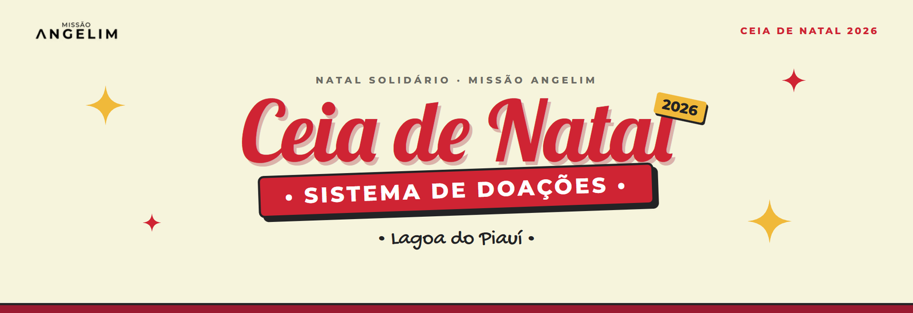
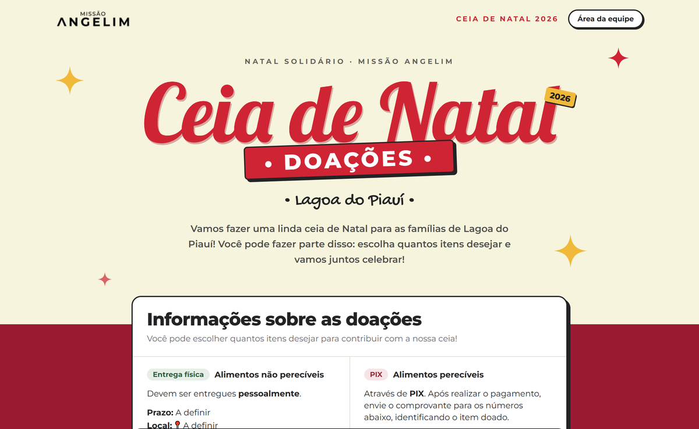
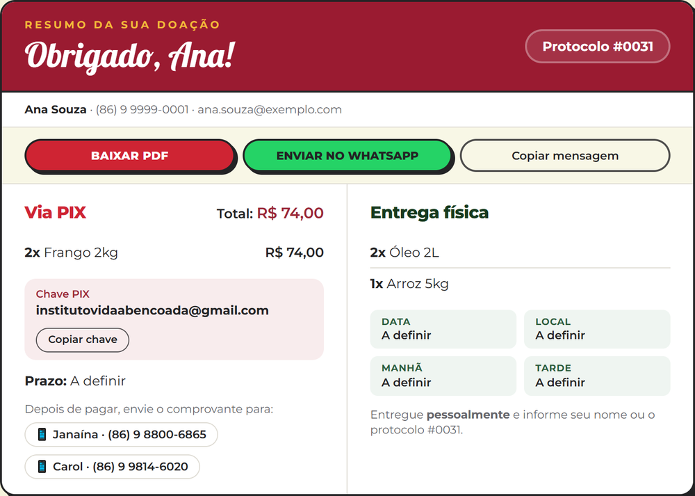
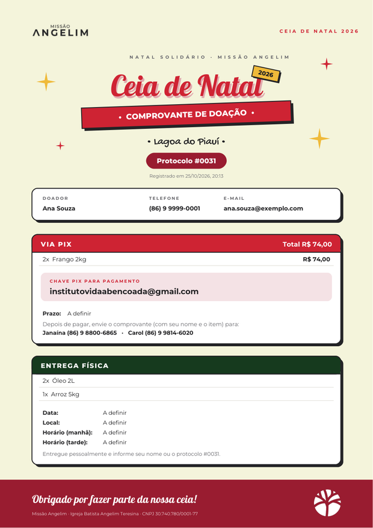
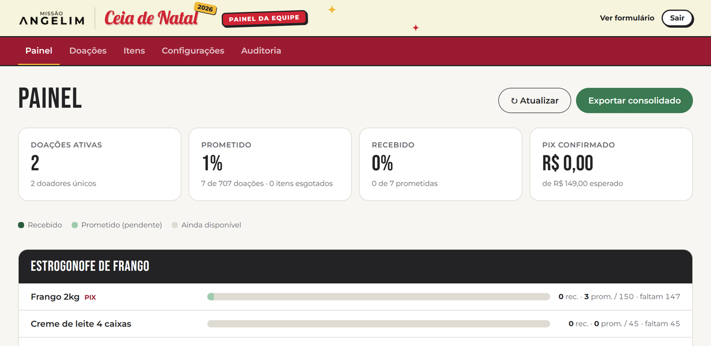
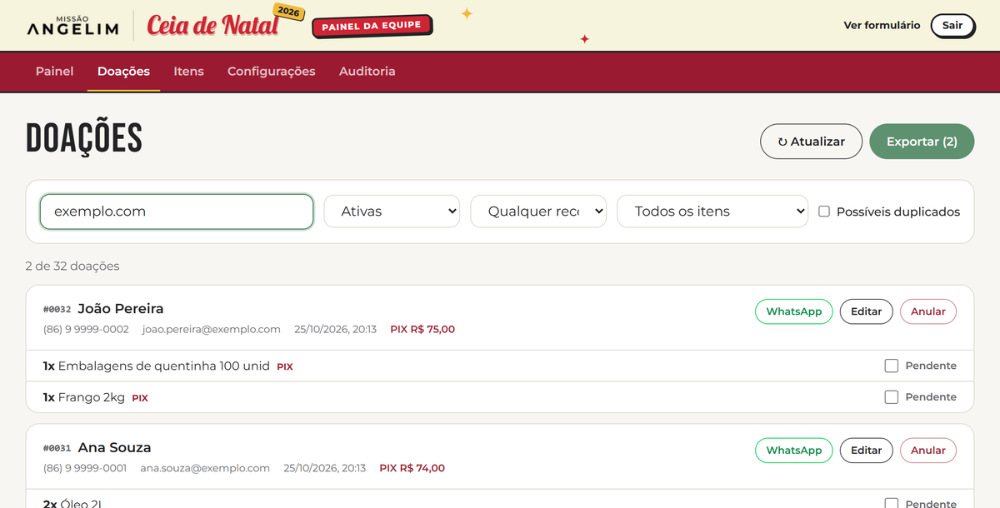
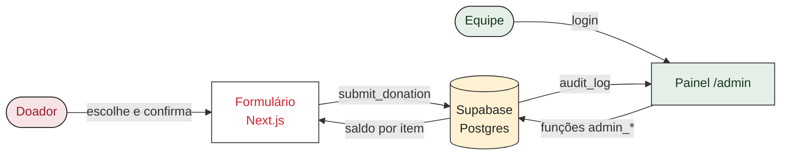

<p align="center">
  
</p>

<p align="center">
  <a href="https://angelim-natal.vercel.app"></a>
  <a href="https://angelim-natal.vercel.app/admin"></a>
  <a href="https://www.angelim.org"></a>
</p>

<p align="center">
  
  
  
  
</p>

<br>

Formulário de doações de alimentos para a **Ceia de Natal 2026** do **Natal Solidário** da [Missão Angelim](https://www.angelim.org), em Lagoa do Piauí. Quem doa escolhe os itens e as quantidades, e o sistema garante que nenhum item passe do limite. A equipe acompanha tudo por um painel com relatório, confirmação de recebimento e auditoria.

> **Guia de uso com as telas:** veja o *Guia do Sistema de Doações* em PDF, disponível com a equipe, ou siga as seções abaixo.

---

## 🎄 Frente pública: para quem doa

<p align="center">
  
</p>

| | |
|---|---|
| **Sem cadastro** | Basta o link. A pessoa preenche e-mail, nome e telefone. |
| **Saldo em tempo real** | Cada item mostra quanto ainda falta. Itens completos aparecem como esgotados. |
| **Limite garantido** | Duas pessoas disputando a última unidade nunca estouram o limite: o banco atende uma de cada vez. |
| **Confirmação protegida** | O botão só libera com os dados preenchidos e pelo menos um item. |
| **PIX ou entrega física** | Frango e embalagens são pagos por PIX. O resto é entregue no local. |

### O resumo da doação

Ao confirmar, a pessoa recebe um **protocolo** e o resumo de tudo o que prometeu, numa tela só:

<p align="center">
  
</p>

Para guardar o compromisso há três opções: **Baixar PDF**, **Enviar no WhatsApp** e **Copiar mensagem**.

<details>
<summary><b>📄 Ver o comprovante em PDF</b></summary>
<br>
<p align="center"></p>
</details>

---

## 🌿 Frente administrativa: para a equipe

Acesse pelo botão **Área da equipe** no topo do formulário ou em [`/admin`](https://angelim-natal.vercel.app/admin). Só e-mails liberados entram.

<p align="center">
  
</p>

| Aba | Para que serve |
|---|---|
| **Painel** | Progresso de cada item (recebido, prometido e disponível), PIX esperado × confirmado e exportação consolidada. |
| **Doações** | Busca e filtros, marcar **recebido / PIX confirmado**, editar, **anular com motivo** e restaurar, WhatsApp com mensagem pronta, alerta de duplicados e exportação para Excel. |
| **Itens** | Alterar limites, ativar ou desativar e criar itens novos. |
| **Configurações** | Datas, local, horários, chave PIX e contatos, e abrir ou fechar o formulário. As mudanças aparecem na hora no site. |
| **Auditoria** | Histórico de cada ação: quem fez, quando e o que mudou. |

<p align="center">
  
</p>

> [!TIP]
> **Nada é apagado.** Anular devolve o saldo e guarda o motivo, e a doação pode ser restaurada depois. Tudo fica registrado na Auditoria.

---

## 🛠️ Como funciona por dentro



- **Next.js 16** (App Router, TypeScript, Tailwind v4). A parte fixa da página aparece na hora e só os valores do banco carregam depois.
- **Supabase** com RLS em todas as tabelas. O público só lê itens e configurações. Toda escrita passa por funções do banco, que verificam `is_admin()` e registram no `audit_log`.
- **Vercel** publica a cada push na `main`. A integração GitHub do Supabase aplica as migrações em [`supabase/migrations`](supabase/migrations).

```
src/
├─ app/
│  ├─ page.tsx              formulário público
│  ├─ actions.ts            envio da doação (server action)
│  ├─ login/                login da equipe
│  └─ admin/                painel, doações, itens, configurações, auditoria
├─ components/              formulário, resumo, topo, painel
└─ lib/                     Supabase, PDF do comprovante, formatação
supabase/migrations/        tabelas, regras de acesso e funções
tests/e2e/                  testes ponta a ponta (Playwright)
docs/                       decisões, pendências e imagens
```

---

## 🚀 Configuração

### 1. Banco (Supabase)

Com a integração GitHub ativa, as migrações rodam sozinhas a cada push. Sem ela, cole os arquivos de [`supabase/migrations`](supabase/migrations) em ordem no **SQL Editor**. Eles podem ser executados mais de uma vez sem problema.

### 2. Acesso da equipe

1. Supabase → **Authentication → Users → Add user**, com e-mail, senha e **Auto Confirm User** marcado.
2. Libere o e-mail no painel com uma migração: `insert into admins(email) values ('email@exemplo.com') on conflict do nothing;`
3. Em **Authentication → Sign In / Providers**, desligue **Allow new users to sign up**.

### 3. Variáveis de ambiente

Na Vercel (**Settings → Environment Variables**) e no `.env.local` da sua máquina (fora do git):

| Variável | Valor |
|---|---|
| `NEXT_PUBLIC_SUPABASE_URL` | URL do projeto Supabase |
| `NEXT_PUBLIC_SUPABASE_PUBLISHABLE_KEY` | Supabase → Project Settings → API Keys → *Publishable key* |
| `RESEND_API_KEY`, `RESEND_FROM` | *(opcional, ainda não usado)* cópia da doação por e-mail |
| `E2E_ADMIN_EMAIL`, `E2E_ADMIN_PASSWORD` | *(só local)* login usado pelos testes |

### 4. Rodar localmente

```bash
npm install
npm run dev        # http://localhost:3000
```

### 5. Testes ponta a ponta

```bash
npm run test:e2e                                                   # build local + Supabase real
E2E_BASE_URL=https://angelim-natal.vercel.app npm run test:e2e     # contra o site publicado
```

Os testes usam o **Edge instalado** e o **banco real**. Eles cobrem: a doação completa, o resumo e as exportações, os limites, o login, recebimento, edição, anulação e restauração, CSV, itens, auditoria, configurações refletidas no site, o botão "Área da equipe", a logo e a seleção de texto. As doações de teste levam `[TESTE E2E]` no nome e são anuladas no final. Para apagá-las de vez antes de divulgar, use o SQL em [`docs/pendencias.md`](docs/pendencias.md).

---

## 📚 Documentação

- [`docs/decisoes.md`](docs/decisoes.md): por que cada escolha foi feita (itens, limites, regras, segurança, identidade visual).
- [`docs/pendencias.md`](docs/pendencias.md): o que falta antes de divulgar e o SQL de limpeza.

<br>

<p align="center">
  
  
  
  
  
</p>

<p align="center">
  <sub><b>Missão Angelim</b> · Igreja Batista Angelim Teresina · Natal Solidário 2026<br>
  <i>"Cada um contribua segundo propôs no seu coração." · 2 Coríntios 9:7</i></sub>
</p>
